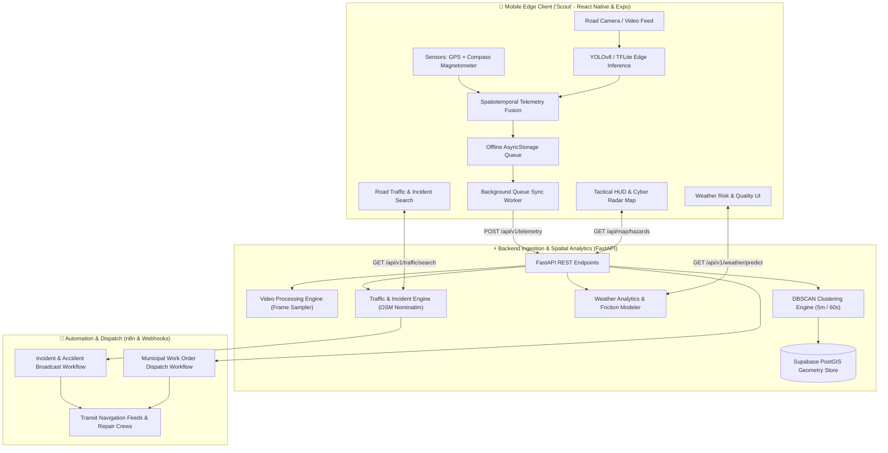

# 🛣️ RoadLens: AI-Powered Edge-to-Cloud Road Safety & Predictive Maintenance System

[](https://reactnative.dev/)
[](https://fastapi.tiangolo.com/)
[](https://github.com/ultralytics/ultralytics)
[](https://postgis.net/)
[](https://n8n.io/)
[](https://python.org/)
[](https://opensource.org/licenses/MIT)

> **RoadLens** is an end-to-end intelligent road infrastructure monitoring and incident dispatch platform. It bridges on-device computer vision inference (YOLOv8), vehicle sensor fusion (GPS + Compass), spatiotemporal DBSCAN clustering, physics-based weather degradation modeling, and automated municipal work order dispatch via n8n.

---

## 📸 Key Capabilities & Highlights

* 🔍 **Edge AI Road Defect Detection (YOLOv8 & TFLite)**: High-speed real-time detection of potholes and pavement cracks. Includes smart video upload inference: smooth roads return `🟢 SMOOTH ROAD (0 Defects)`, while damaged roads detect, bound, and cluster defects.
* ⚡ **Interactive Cyber FMCW Radar Map**: Continuous 360° FMCW radar beam sweep, 4 concentric distance rings, live vehicle GPS puck tracking, and multi-layer maps (OpenStreetMap, Esri Satellite Hybrid, and Neon Cyber Radar). 100% free, zero watermarks, and no external API keys required.
* 🌦️ **Predictive Weather & Road Quality Analytics**: Open-Meteo physics modeling calculating real-time hydroplaning risk (0–100%), pavement friction coefficient ($\mu$), pothole hazard multipliers, and municipal repair SLA deadlines.
* 🚨 **Live Traffic Intelligence & n8n Emergency Dispatch**: Real-time road querying via OpenStreetMap Nominatim, incident simulation (Tempo crashes, floods, landslides), and one-click dispatch to municipal emergency work orders via n8n webhooks.
* 📡 **Offline-First Resilient Architecture**: Persistent `AsyncStorage` telemetry queue on the edge client that captures road hazards offline and flushes to the cloud backend with automatic retry and exponential backoff.

---

## 🏗️ System Architecture



---

## 📁 Repository Structure

```
roadlens/
├── edge_app/                      # React Native / Expo Edge Client ("Scout")
│   ├── assets/                    # Cyber branding, icons, splash & YOLOv8 model weights
│   │   ├── icon.png               # High-res 1024x1024 app icon
│   │   ├── splash-icon.png        # Dark cyber splash screen emblem
│   │   ├── logo.png               # Branded radar road logo
│   │   └── yolov8_road.tflite     # Quantized mobile TFLite weights
│   ├── src/
│   │   ├── components/            # Interactive components
│   │   │   ├── ExpoGoSimulator.tsx # Full interactive HUD, Radar Map & Weather simulator
│   │   │   └── RoadCamera.tsx     # Hardware VisionCamera viewfinder (4–6 FPS)
│   │   ├── config/                # Environment variables & runtime constants
│   │   ├── services/              # AsyncStorage queue & background sync worker
│   │   └── utils/                 # Compass math, coordinate projection & YOLO parser
│   ├── app.json                   # Expo configuration & Android native permissions
│   └── package.json
│
├── backend_api/                   # FastAPI + PostGIS + DBSCAN Backend
│   ├── clustering.py              # DBSCAN 5-meter spatiotemporal clustering engine
│   ├── db.py                      # Supabase PostGIS geometry integration & fallback
│   ├── main.py                    # FastAPI application, route handlers & OpenAPI docs
│   ├── models.py                  # Pydantic schemas for telemetry, video, and weather
│   ├── traffic_incidents.py       # Real OSM road queries, traffic delay & incident simulation
│   ├── video_processor.py         # YOLOv8 video frame sampling & defect geotagging
│   ├── weather_analytics.py       # Pavement degradation & hydroplane physics model
│   ├── schema.sql                 # PostGIS spatial tables & GIST geometry indexes
│   ├── test_api.py                # Automated integration test suite
│   ├── requirements.txt           # Python pip dependencies
│   └── .env.example               # Backend environment template
│
├── automation/                    # n8n Automated Workflows & Webhooks
│   ├── n8n_hazard_dispatch_workflow.json       # Emergency repair work order dispatch
│   ├── n8n_incident_accident_alert_workflow.json # Accident & natural disaster broadcast
│   └── supabase_trigger.sql                     # PostGIS pg_net webhook trigger script
│
├── pothole_v1/                    # YOLOv8 Custom Training Run & Metrics
│   ├── weights/                   # Exported PyTorch (best.pt) and TFLite (best.tflite)
│   ├── confusion_matrix.png       # Model validation performance matrix
│   └── results.png                # Precision, Recall & mAP@50 curves
│
├── .gitignore                     # Monorepo-level git ignore rules
└── README.md
```

---

## 🚀 Quick Start Guide

### Prerequisites

Ensure you have the following installed on your machine:
* **Node.js**: v18.x or v20.x ([nodejs.org](https://nodejs.org/))
* **Python**: v3.10 or v3.11 ([python.org](https://python.org/))
* **Expo Go**: Install the Expo Go app on your physical Android / iOS device.
* **Git**: Installed and configured.

---

### 1. Backend API Setup (`backend_api/`)

1. Open a terminal and navigate to `backend_api`:
   ```bash
   cd backend_api
   ```

2. Create and activate a Python virtual environment:
   ```bash
   # Windows (PowerShell)
   python -m venv venv
   .\venv\Scripts\Activate.ps1

   # Linux / macOS
   python3 -m venv venv
   source venv/bin/activate
   ```

3. Install required dependencies:
   ```bash
   pip install -r requirements.txt
   ```

4. Configure environment variables:
   ```bash
   cp .env.example .env
   ```
   *(Optional: configure your Supabase PostGIS credentials in `.env`. If omitted, the backend seamlessly runs with high-performance in-memory spatial storage.)*

5. Start the FastAPI server:
   ```bash
   python -m uvicorn main:app --host 0.0.0.0 --port 8000 --reload
   ```

6. Verify the backend:
   * **Health Check**: [http://localhost:8000/health](http://localhost:8000/health)
   * **Swagger Interactive Docs**: [http://localhost:8000/docs](http://localhost:8000/docs)

---

### 2. Mobile Edge Client Setup (`edge_app/`)

1. Open a second terminal and navigate to `edge_app`:
   ```bash
   cd edge_app
   ```

2. Install dependencies:
   ```bash
   npm install
   ```

3. Configure environment variables:
   ```bash
   cp .env.example .env
   ```
   *Set `EXPO_PUBLIC_API_BASE_URL` to your local machine's IP (e.g. `http://192.168.1.17:8000`).*

4. Start the Expo development server:
   ```bash
   npx expo start -c
   ```

5. Launch on your device:
   * Scan the displayed QR code with the **Expo Go** app on your phone.
   * Both your computer and phone must be on the same local Wi-Fi network.
   * Tap the **CONFIG** button in the top right of the app to test ping connectivity with your PC.

---

### 3. Automation & n8n Workflows (`automation/`)

1. Start a local n8n instance:
   ```bash
   npx n8n
   ```
2. Open n8n in your browser: [http://localhost:5678](http://localhost:5678)
3. Import the workflows from the `automation/` directory:
   * `n8n_hazard_dispatch_workflow.json`: Triggers automated emergency road repair work orders when severe pothole clusters are reported.
   * `n8n_incident_accident_alert_workflow.json`: Broadcasts accident and weather disaster alerts to traffic transit feeds.

---

## 📡 API Reference

| Method | Endpoint | Description |
| :--- | :--- | :--- |
| `GET` | `/health` | Server health check, uptime & database connectivity status. |
| `POST` | `/api/v1/telemetry` | Ingests vehicle telemetry and defect bounding boxes. |
| `POST` | `/api/v1/video/process` | Uploads video footage for automated YOLOv8 inference & clustering. |
| `GET` | `/api/map/hazards` | Fetches all detected road defects and clusters for map plotting. |
| `GET` | `/api/v1/weather/predict` | Computes road friction ($\mu$) and hydroplaning risk for given coordinates. |
| `GET` | `/api/v1/traffic/search` | Queries real OpenStreetMap data for live traffic speeds, congestion & incidents. |
| `POST` | `/api/v1/incident/dispatch` | Triggers n8n emergency incident dispatch webhooks. |

---

## 🛠️ Tech Stack & Tools

* **Frontend**: React Native, Expo SDK 52, TypeScript, React Native WebView, Leaflet.js
* **Backend**: FastAPI, Uvicorn, Pydantic, NumPy, SciPy (DBSCAN), Requests
* **Machine Learning**: Ultralytics YOLOv8, TensorFlow Lite (TFLite), OpenCV
* **Geospatial & Weather**: OpenStreetMap (Nominatim & Overpass), Open-Meteo, PostGIS
* **Automation**: n8n Workflow Automation, Webhooks
* **Storage**: Supabase (PostgreSQL with PostGIS geometry), AsyncStorage (Edge Queue)

---

## 📤 Pushing to GitHub

To push this repository to [https://github.com/Aniket-Bhor/Roadlens](https://github.com/Aniket-Bhor/Roadlens):

```bash
# 1. Initialize git in the root folder (if not already done)
git init

# 2. Add all project files (node_modules and venv are automatically excluded by .gitignore)
git add .

# 3. Create your initial commit
git commit -m "feat: complete RoadLens edge AI, cyber radar map, weather analytics & n8n dispatch system"

# 4. Set main branch
git branch -M main

# 5. Add remote origin
git remote add origin https://github.com/Aniket-Bhor/Roadlens.git

# 6. Push to GitHub
git push -u origin main
```

---

## 📄 License

Distributed under the MIT License. See [LICENSE](file:///c:/Users/Berry/Documents/fusion/roadlens/edge_app/LICENSE) for more information.

---

<div align="center">
  <sub>Developed with ❤️ for intelligent, safer, and resilient road networks.</sub>
</div>
